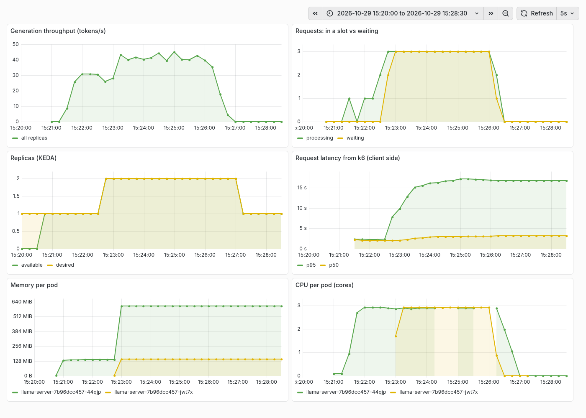
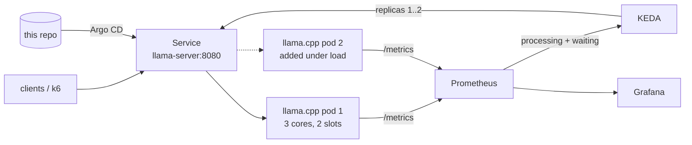

# llm-platform-k8s

[](https://github.com/spandanmandal1/llm-platform-k8s/actions/workflows/ci.yaml)

**Self-hosted LLM inference on Kubernetes that adds a replica when requests start queueing.**
llama.cpp serves a small open model, KEDA scales it on queue depth, Argo CD deploys everything from this
repo, and Prometheus and Grafana show what happens under load.



*A real 5-minute k6 run on a laptop. When users outnumber the request slots, requests wait, KEDA adds a second
replica, throughput rises from ~30 to ~45 tokens/s, and the replica is removed after the load ends.*

## How it works



- **Model:** Qwen2.5-0.5B-Instruct (Q4_K_M GGUF, 469 MB), served by llama.cpp `server-v0.5.0` through its
  OpenAI-compatible API. Downloaded once on the host and mounted into the cluster, never baked into an image.
- **Scaling signal:** `llamacpp:requests_processing + llamacpp:requests_deferred`, divided by the 2 slots each
  replica has. CPU usage is a poor signal for LLM serving because one request already saturates its cores.
- **Each replica owns its cores** (`--threads 3`, CPU limit 3), so a second replica adds real throughput on an
  8-core machine instead of competing for the same cores.
- **GitOps:** an Argo CD app-of-apps installs KEDA first, then Prometheus and Grafana, then the model server.
- **Works with [alert-triage-bot](https://gitlab.com/spandanmandal/alert-triage-bot):** the Service is
  `llama-server` in namespace `llm` on port 8080, that project's default LLM address, so the two connect with no
  configuration. Tested: alert-triage-bot's released image (`registry.gitlab.com/spandanmandal/alert-triage-bot:0.1.0`),
  installed into this cluster with only `dryRun=true` set, received an alert, called
  `http://llama-server.llm.svc:8080/v1` and posted its triage 14.9 s later.

## Results

Same 5-minute k6 test (1 user for 1 min, then 6 users, 64-token answers), with and without autoscaling.
Laptop: 8-core Ryzen 5 3550H, no GPU, 5.8 GB RAM. Raw output in [`docs/`](docs/).

| | 1 replica (scaling off) | Autoscaling 1 → 2 | Change |
|---|---|---|---|
| Requests completed (0 failed in both) | 145 | 188 | **+30%** |
| Median latency (p50) | 9.98 s | 3.15 s | **−68%** |
| p95 latency | 15.54 s | 16.75 s | no better |
| Peak generation throughput | 37.8 tokens/s | 45.2 tokens/s | +20% |
| Time from scale-up decision to second replica ready | | ~5 s | |

**Why p95 didn't improve:** Kubernetes Services balance per TCP connection, not per request. k6 reuses its
connections, so most users stayed pinned to the first pod while the second had spare slots (visible in the
"in a slot vs waiting" panel: requests kept waiting with two replicas up). Requests that queued before the
second replica started also count towards p95. The fix is a request-aware load balancer in front of the pods,
such as an Envoy or Gateway API inference extension routing on queue depth. That's the next step.

**Memory:** the whole cluster, including Argo CD, Prometheus, Grafana, KEDA and two model replicas, peaked at
about 2.4 GB. Each model replica uses roughly 400–600 MB.

## Run it

Needs Docker, kind, helm, kubectl and about 3 GB of free RAM.

```bash
mkdir -p ~/models && curl -L -o ~/models/qwen2.5-0.5b-instruct-q4_k_m.gguf \
  https://huggingface.co/Qwen/Qwen2.5-0.5B-Instruct-GGUF/resolve/main/qwen2.5-0.5b-instruct-q4_k_m.gguf

make up      # kind cluster + Argo CD; Argo CD deploys the rest from GitHub (a few minutes)
make smoke   # one chat completion through the OpenAI-compatible API
make load    # 5-minute k6 run; watch Grafana while it runs
make down
```

| URL | What |
|---|---|
| http://localhost:8080/v1/chat/completions | OpenAI-compatible API |
| http://localhost:3000/d/llm-platform | Grafana dashboard |
| http://localhost:9090 | Prometheus |
| http://localhost:8443 | Argo CD (read-only without login) |

`make manual` deploys the same stack with plain `helm install`, without Argo CD.

## CI

GitHub Actions lints the chart and the Argo CD apps, then runs a **smoke test on a real kind cluster**: it
downloads the model (cached), deploys the chart and checks that a chat completion and the metrics endpoint
work.

## Problems found while building it

- **llama.cpp rejected `--host=0.0.0.0`.** It wants flag and value as separate arguments. The pod crash-looped
  until the chart was changed.
- **Prometheus refused to start** with a 5 s scrape interval because the default scrape timeout (10 s) is
  longer than the interval.
- **Argo CD's Service asked for the same NodePort twice** (HTTP and HTTPS) when only one port was set.
- **Scaling helped the median but not p95**, because of per-connection load balancing. Explained above.

## Layout

```
charts/llama-server/   Deployment, Service, KEDA ScaledObject
argocd/                app-of-apps: root.yaml + apps/
platform/              values for Prometheus, Grafana, KEDA, Argo CD (sized for a laptop)
dashboards/llm.json    Grafana dashboard
loadtest/k6.js         ramping load test
kind/cluster.yaml      single-node cluster, model mount, port mappings
```
